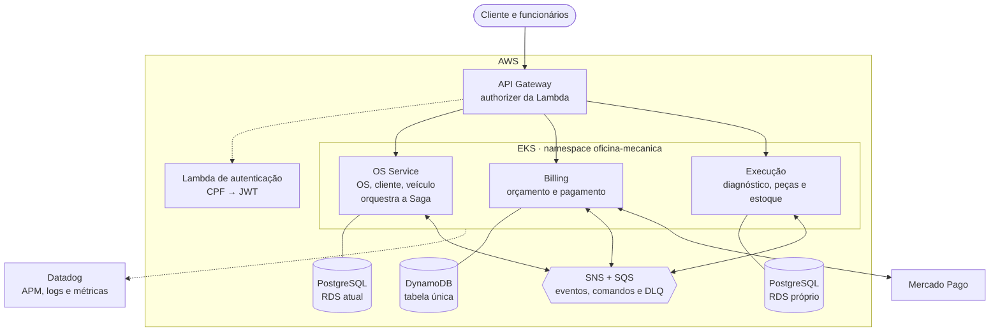
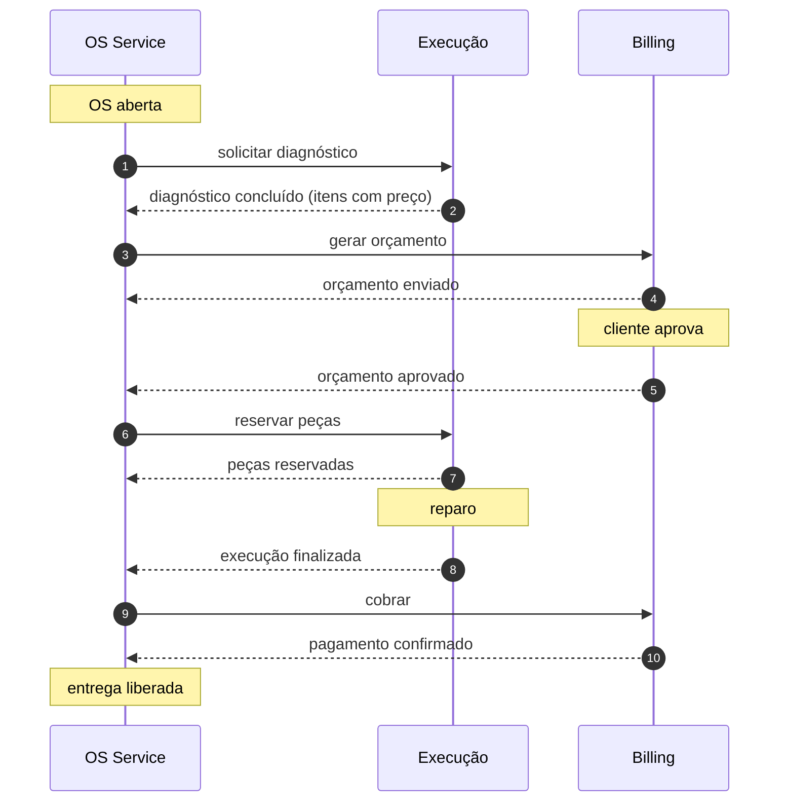

# Arquitetura da Fase 4 — microsserviços

> **Status:** desenho aceito na Sprint 1 (ADRs [0003](../../adrs/0003-divisao-em-microsservicos.md) a [0006](../../adrs/0006-banco-por-servico.md), 2026-10-17). Ainda não implementado por inteiro: mensageria, bancos novos e Saga entram nas Sprints 2 a 4. É a base do diagrama geral da entrega ([F4-40](https://github.com/tech-challenge-grupo-160/tech-challenge-oficina-mecanica/issues/171)).

## Visão geral

| Serviço | Repositório | Banco | Responsabilidade |
|---|---|---|---|
| OS Service | [tech-challenge-oficina-mecanica](https://github.com/tech-challenge-grupo-160/tech-challenge-oficina-mecanica) | PostgreSQL (RDS atual) | Cliente, veículo, OS e seu status, histórico, acompanhamento público, notificações, login de funcionários e orquestração da Saga |
| Billing | [tech-challenge-oficina-mecanica-billing](https://github.com/tech-challenge-grupo-160/tech-challenge-oficina-mecanica-billing) | DynamoDB | Orçamento (gerar, enviar, aprovar, recusar) e pagamento via Mercado Pago |
| Execução | [tech-challenge-oficina-mecanica-execucao](https://github.com/tech-challenge-grupo-160/tech-challenge-oficina-mecanica-execucao) | PostgreSQL (RDS próprio) | Diagnóstico e reparo, fila de execução, catálogo de serviços e peças, estoque e pedidos de compra |

Regras que o desenho assume:

- **Nenhum serviço acessa o banco de outro.** Dado de outro serviço chega por evento, com cópia mínima local. O CPF não sai do OS Service.
- **Só o OS Service altera o status da OS**, sempre em reação a eventos.
- **REST síncrono entre serviços** só na validação do catálogo na abertura da OS (OS Service → Execução, pelo DNS do cluster).
- **Mensageria com outbox e consumo idempotente**; toda fila tem DLQ ([ADR-0005](../../adrs/0005-mensageria-sns-sqs.md)).

## Caminho feliz da Saga

Saga orquestrada pelo OS Service ([ADR-0004](../../adrs/0004-saga-orquestrada.md)). O pagamento continua no fim, depois da execução.

Compensações, quando um passo falha:

| Falha | O que é desfeito |
|---|---|
| Orçamento recusado ou expirado (7 dias) | Billing cancela o orçamento; OS cancelada |
| Falta de estoque | Pedido de compra gerado e OS aguardando estoque; se cancelada, Execução libera as reservas |
| Execução abortada | Execução devolve as peças ao estoque; Billing cancela o orçamento; OS cancelada |
| Pagamento recusado | Nada é desfeito (o conserto já foi feito): a OS aguarda pagamento e a cobrança é repetida |
