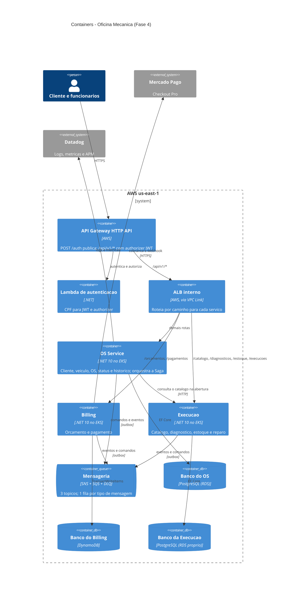

# C4 — containers (Fase 4)

Os três microsserviços, seus bancos e a mensageria entre eles. Para o PDF, exporte a
imagem como descrito em [Exportar para imagem](../README.md#exportar-para-imagem).

Regras que o desenho assume ([ADR-0003](../../adrs/0003-divisao-em-microsservicos.md) a
[ADR-0006](../../adrs/0006-banco-por-servico.md)):

- **Nenhum serviço acessa o banco de outro.** Dado de outro serviço chega por
  mensagem ou, na abertura da OS, pela consulta ao catálogo da Execução.
- **Só o OS Service altera o status da OS**, sempre em reação a eventos.
- **Mensageria com outbox e consumo idempotente.** Comandos vão por envio
  direto à fila do serviço de destino; eventos vão pelo tópico do produtor, e a
  fila do OS filtra pelo atributo `tipo`. Toda fila tem DLQ.
- Os três serviços mandam logs e métricas ao Datadog. A seta sai só do OS para
  o desenho não ficar poluído.
