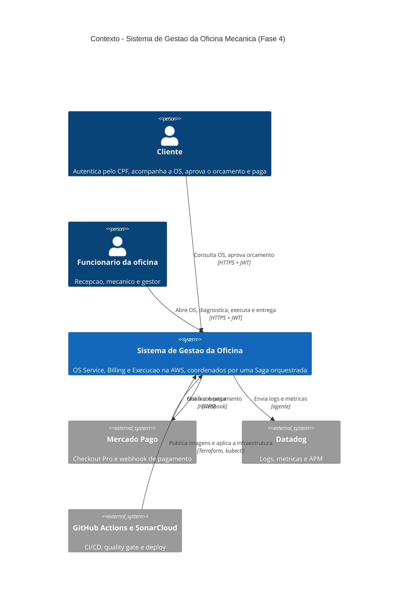

# C4 — contexto (Fase 4)

Quem usa o sistema e com quais sistemas externos ele conversa. Para o PDF, exporte a
imagem como descrito em [Exportar para imagem](../README.md#exportar-para-imagem).

| Elemento | Papel |
|---|---|
| Cliente | Autentica pelo CPF na Lambda, acompanha a OS e decide o orçamento |
| Funcionário | Opera a OS: abertura, diagnóstico, reparo e entrega |
| Mercado Pago | Recebe a cobrança do Billing e avisa o resultado por webhook |
| Datadog | Recebe logs estruturados (com `correlationId` e número da OS) e métricas |
| GitHub Actions e SonarCloud | Pipeline de cada serviço: testes, quality gate de 80%, imagem no ECR e deploy no EKS |
