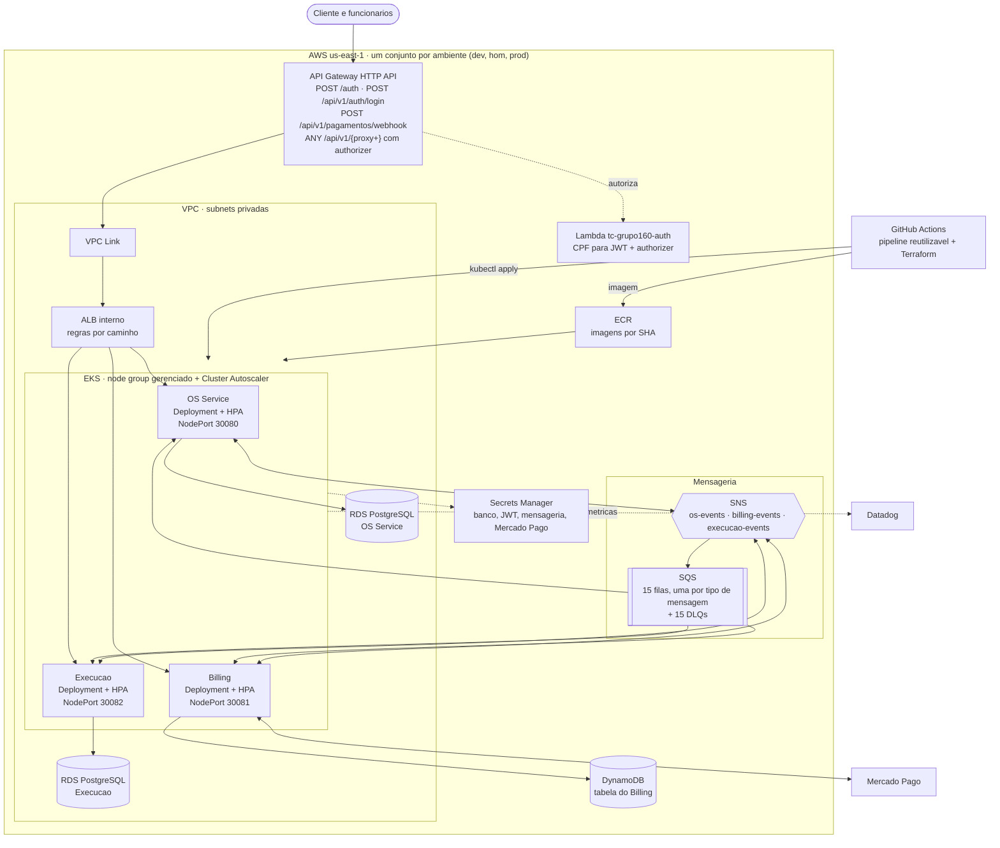

# Implantação na AWS (Fase 4)

Onde cada peça roda em cada ambiente (dev, hom e prod), e quais repositórios as
provisionam. Substitui, para a aplicação, o
[diagrama da Fase 3](../fase-3/aws-deployment.md), que tinha uma API só. Para o PDF,
exporte a imagem como descrito em [Exportar para imagem](../README.md#exportar-para-imagem).

| Repositório | O que provisiona |
|---|---|
| [tech-challenge-infra-k8s](https://github.com/tech-challenge-grupo-160/tech-challenge-infra-k8s) | VPC, EKS, ALB, API Gateway, VPC Link, authorizer e segredos compartilhados |
| [tech-challenge-infra-database](https://github.com/tech-challenge-grupo-160/tech-challenge-infra-database) | RDS do OS Service e RDS da Execução |
| [tech-challenge-lambda-auth](https://github.com/tech-challenge-grupo-160/tech-challenge-lambda-auth) | Código das funções Lambda (autenticação por CPF e authorizer) |
| OS Service, Billing e Execução (`infra/`) | Tópico SNS de cada um, filas, DLQs e segredo de mensageria; a tabela DynamoDB fica no Billing |
| [tech-challenge-pipelines](https://github.com/tech-challenge-grupo-160/tech-challenge-pipelines) | Pipeline reutilizável: testes, SonarCloud, imagem no ECR e deploy no EKS |

O ciclo de subir e derrubar os ambientes no Learner Lab está em
[CICLO-DE-VIDA.md](../../CICLO-DE-VIDA.md).
