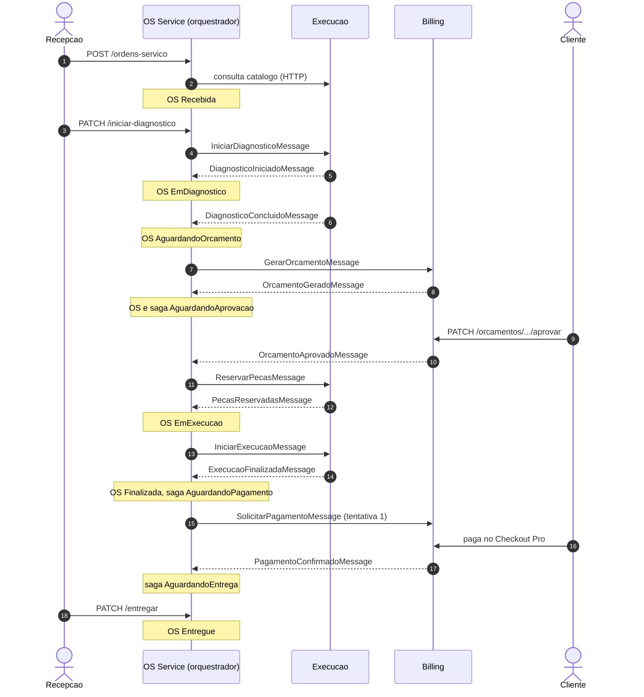
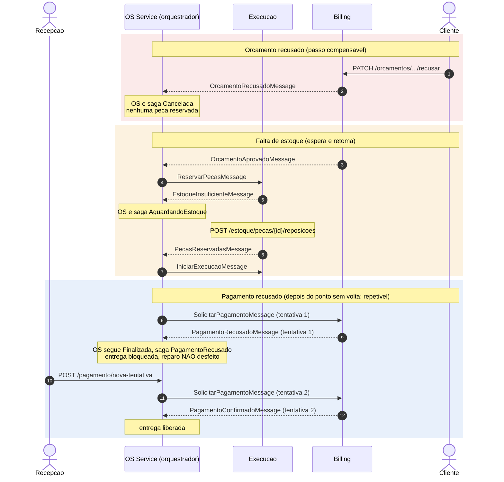

# Sequência da Saga (Fase 4)

Saga orquestrada pelo OS Service ([ADR-0004](../../adrs/0004-saga-orquestrada.md)).
Os nomes são os das mensagens reais ([catálogo](../../mensageria/catalogo.md)).
Comandos (→) vão direto à fila do serviço; eventos (⇢) vão pelo tópico SNS do
produtor até a fila do OS. Todos os passos são cobertos pelo
[BDD](../../../README.md#bdd-do-fluxo-completo-da-os-f4-36).

Para o PDF, exporte cada diagrama como descrito em
[Exportar para imagem](../README.md#exportar-para-imagem).

## Caminho feliz

## Compensações

| Falha | Tipo de passo | Tratamento |
|---|---|---|
| Orçamento recusado | Compensável | OS e saga `Cancelada`; nenhum comando de reserva é enviado |
| Falta de estoque | Compensável (espera) | OS em `AguardandoEstoque`; a reposição completa a reserva e a saga retoma |
| Pagamento recusado | Repetível (depois do *pivot*) | O reparo não é desfeito; a OS segue `Finalizada` sem pagamento e uma nova tentativa gera outro pagamento no Billing, sem duplicar cobrança |
| Mensagem repetida | — | Inbox por `MessageId`: o passo não se repete |

Fora do escopo desta fase: expiração do orçamento por tempo e falha da execução
com devolução de peças (decisão de 13/11/2026 no board).
